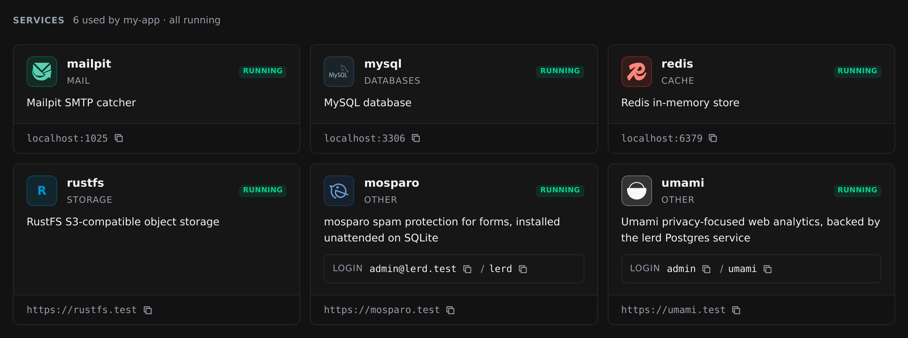

# Site Services

A [lerd](https://lerd.sh) plugin that adds a **Services** tab to every site, listing the services the site uses with their logo, status, description, default login and address. The same list is available to AI assistants through the MCP tool `site-services_list`.



## Install

```sh
lerd plugin install https://github.com/ExeQue/lerd-plugin-site-services.git
```

Reload the dashboard and open a site's **Services** tab. See [DOCS.md](DOCS.md) for everything it shows.

## Requirements

`python3` on the machine lerd runs on.

## License

MIT, see [LICENSE](LICENSE).
